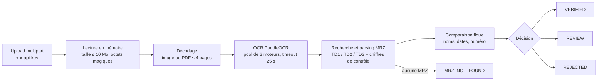

# Service de vérification CNI / passeport (MRZ)

Web service FastAPI (dossier `cni_service/`) qui vérifie que les informations saisies par un utilisateur (nom, prénoms, date de naissance, date d'expiration…) correspondent à sa pièce d'identité, carte nationale d'identité ou passeport. Le document est lu par PaddleOCR. La comparaison s'appuie sur la MRZ (zone de lecture automatique, norme OACI 9303), dont les chiffres de contrôle sont validés.



Les documents ne sont jamais écrits sur disque. Les logs ne contiennent aucune donnée personnelle (`request_id`, route, statut, décision, durée).

## Sommaire

- [Démarrage rapide (Docker)](#démarrage-rapide-docker)
- [Déploiement en production sur un VPS](#déploiement-en-production-sur-un-vps)
- [Référence API](#référence-api)
- [Méthodes les plus utilisées](#méthodes-les-plus-utilisées)
- [Développement local et tests](#développement-local-et-tests)
- [Configuration](#configuration)
- [Limites connues](#limites-connues)

## Arborescence

```
cni_service/
├── app/
│   ├── main.py         # routes, modèles Pydantic, sécurité, pool OCR, décision
│   ├── mrz.py          # parsing MRZ TD1/TD2/TD3 et chiffres de contrôle
│   ├── matching.py     # normalisation et similarité floue des noms
│   ├── ocr_engine.py   # enveloppe PaddleOCR
│   └── viz.py          # champs imprimés de la zone visuelle
├── tests/              # 15 tests, faux moteur OCR
├── Dockerfile
├── compose.yaml
├── requirements.txt    # dépendances directes
├── requirements.lock   # versions exactes testées (Python 3.12)
└── openapi.json        # schéma OpenAPI exporté
```

## Démarrage rapide (Docker)

Toutes les commandes se lancent depuis `cni_service/`.

Générer une clé API :

```bash
python3 -c "import secrets; print(secrets.token_urlsafe(32))"
```

Créer le fichier `.env` (jamais versionné) avec la clé générée :

```bash
echo "API_KEY=<clé-générée>" > .env
```

Construire l'image (≈ 2,8 Go, les modèles OCR sont téléchargés pendant le build) :

```bash
docker compose build
```

Démarrer le service :

```bash
docker compose up -d
```

Vérifier qu'il répond (le chargement des 2 moteurs OCR prend quelques dizaines de secondes) :

```bash
curl http://127.0.0.1:8000/health
```

Réponse attendue : `{"status":"ok"}`. `docker compose ps` doit afficher l'état `healthy`.

Caractéristiques de l'image et du conteneur :

- Python 3.12 (`python:3.12-slim-bookworm`), utilisateur non-root `app` (uid 10001).
- Modèles OCR intégrés au build : aucun téléchargement en production (`PADDLE_PDX_DISABLE_MODEL_SOURCE_CHECK=True`).
- `HEALTHCHECK` sur `/health` (intervalle 30 s, délai de démarrage 90 s).
- `compose.yaml` : système de fichiers en lecture seule, `tmpfs` sur `/tmp`, `cap_drop: ALL`, `no-new-privileges`, `mem_limit: 4g`, `restart: unless-stopped`, `env_file: .env`.

## Déploiement en production sur un VPS

Cible de référence : Hostinger KVM 2 (2 vCPU AMD EPYC, 8 Go de RAM, 100 Go NVMe, sans GPU). C'est suffisant pour un trafic faible à modéré. Au-delà, passer en KVM 4 et augmenter `MAX_CONCURRENT_ANALYSES` (voir [Configuration](#configuration)).

### 1. Installer Docker

Sur Ubuntu/Debian, avec le script officiel :

```bash
curl -fsSL https://get.docker.com | sudo sh
```

```bash
sudo usermod -aG docker $USER
```

Se reconnecter pour que le groupe `docker` soit pris en compte.

### 2. Transférer le projet ou l'image

**Option A : build sur le VPS.** Copier le dossier (sans `.venv` ni `.env`) puis construire :

```bash
rsync -av --exclude .venv --exclude .env --exclude __pycache__ cni_service/ user@vps:/opt/cni_service/
```

```bash
cd /opt/cni_service && docker compose build
```

**Option B : image construite en local**, transférée par archive :

```bash
docker save cni-service:latest | gzip > cni-service.tar.gz
```

```bash
scp cni-service.tar.gz cni_service/compose.yaml user@vps:/opt/cni_service/
```

```bash
gunzip -c /opt/cni_service/cni-service.tar.gz | docker load
```

**Option C : registre privé** (GHCR, Docker Hub…) :

```bash
docker tag cni-service:latest registry.example.com/cni-service:1.0.0
```

```bash
docker push registry.example.com/cni-service:1.0.0
```

Puis, sur le VPS, renseigner cette image dans `compose.yaml` et lancer `docker compose pull`.

Avec les options B et C, `docker compose up` réutilise l'image déjà présente ; ne pas lancer `docker compose build` sur le VPS.

### 3. Fichier `.env`

```bash
python3 -c "import secrets; print(secrets.token_urlsafe(32))"
```

```bash
install -m 600 /dev/null /opt/cni_service/.env
```

Éditer `/opt/cni_service/.env` et y mettre `API_KEY=<clé-générée>`. Sans `API_KEY`, le service démarre mais refuse toutes les requêtes sur `/verify` et `/extract` (un message d'erreur est journalisé au démarrage).

### 4. Démarrer le service

```bash
docker compose up -d
```

Le `compose.yaml` publie le port sur `127.0.0.1:8000` uniquement : le conteneur n'est joignable que depuis le VPS lui-même, donc par le reverse proxy. Ne pas le remplacer par `8000:8000` : les ports publiés par Docker contournent les règles UFW, le pare-feu seul ne protégerait pas le service.

### 5. Reverse proxy HTTPS

Une analyse peut durer jusqu'à 25 s et l'upload atteindre 10 Mo : prévoir un timeout ≥ 60 s et une taille de corps ≥ 11 Mo.

**Caddy** (certificat Let's Encrypt automatique), `/etc/caddy/Caddyfile` :

```
api.example.com {
    request_body {
        max_size 11MB
    }
    reverse_proxy 127.0.0.1:8000 {
        transport http {
            read_timeout 60s
            write_timeout 60s
        }
    }
}
```

**Nginx** (certificat obtenu avec certbot), extrait de `server` :

```nginx
server {
    listen 443 ssl http2;
    server_name api.example.com;

    ssl_certificate     /etc/letsencrypt/live/api.example.com/fullchain.pem;
    ssl_certificate_key /etc/letsencrypt/live/api.example.com/privkey.pem;

    client_max_body_size 11m;

    location / {
        proxy_pass http://127.0.0.1:8000;
        proxy_set_header Host $host;
        proxy_set_header X-Forwarded-For $proxy_add_x_forwarded_for;
        proxy_set_header X-Forwarded-Proto $scheme;
        proxy_read_timeout 60s;
        proxy_send_timeout 60s;
    }
}
```

Le service n'active pas CORS : il est prévu pour être appelé depuis un backend, jamais directement depuis un navigateur (la clé API serait exposée).

### 6. Pare-feu

N'ouvrir que SSH et HTTPS (le port 80 reste utile pour le challenge HTTP de Let's Encrypt et la redirection) :

```bash
sudo ufw allow OpenSSH
```

```bash
sudo ufw allow 80,443/tcp
```

```bash
sudo ufw enable
```

### 7. Exploitation

Suivre les logs (une ligne par requête : `request_id`, `path`, `status`, `decision`, `duration_ms`) :

```bash
docker compose logs -f --tail 100
```

Vérifier l'état et la consommation mémoire (≈ 1,1 Go par moteur OCR, 2 moteurs) :

```bash
docker stats --no-stream
```

Mettre à jour (option A) après avoir recopié le code :

```bash
docker compose up -d --build
```

Mettre à jour (options B/C) : charger ou tirer la nouvelle image, puis :

```bash
docker compose up -d
```

Faire tourner la clé API : générer une nouvelle clé, remplacer la valeur dans `.env`, puis recréer le conteneur (un simple `restart` ne relit pas `env_file`) :

```bash
docker compose up -d --force-recreate
```

Le service n'accepte qu'une seule clé à la fois : mettre à jour les clients appelants au même moment.

Nettoyer les anciennes images après une mise à jour :

```bash
docker image prune -f
```

## Référence API

| Route | Méthode | Authentification | Rôle |
|---|---|---|---|
| `/health` | GET | aucune | Sonde de vie : `{"status": "ok"}` |
| `/verify` | POST | `x-api-key` | Compare les données saisies à la MRZ du document |
| `/extract` | POST | `x-api-key` | Renvoie la MRZ et les champs imprimés lus |

Les routes `/verify` et `/extract` reçoivent du `multipart/form-data`. L'en-tête `x-api-key` doit être égal à la variable d'environnement `API_KEY` (comparaison à temps constant) ; sinon réponse 401. La documentation interactive est servie sur `/docs`, le schéma sur `/openapi.json` (copie dans `cni_service/openapi.json`).

### `POST /verify`

| Champ | Type | Requis | Description |
|---|---|---|---|
| `file` | fichier | oui | Image (JPEG, PNG, WebP) ou PDF de 4 pages max : recto et verso de la CNI, ou page photo du passeport |
| `firstName` | texte | oui | Un des prénoms, ou tous les prénoms séparés par des espaces. Comparé à chaque prénom de la MRZ et à l'ensemble des prénoms ; le meilleur score est retenu |
| `lastName` | texte | oui | Nom de famille |
| `birthDate` | date `YYYY-MM-DD` | non | Vérifiée seulement si fournie |
| `otherFirstNames` | texte | non | Autres prénoms séparés par des espaces, comparés aux prénoms de la MRZ à partir du deuxième |
| `profession` | texte | non | Absente de la MRZ : recherche floue dans le texte OCR, informative |
| `threshold` | nombre 0,5 à 1 | non | Score minimal de similarité des noms (défaut `0.85`) |
| `documentType` | `cni` ou `passport` | non | Format MRZ cherché en priorité : `cni` → TD1/TD2, `passport` → TD3 |
| `documentNumber` | texte | non | Numéro de la pièce ; comparaison informative, ne change jamais la décision |
| `documentExpiresAt` | date `YYYY-MM-DD` | non | Date d'expiration ; vérifiée si fournie et prise en compte dans la décision |

Valeurs de `decision` :

| Valeur | Signification |
|---|---|
| `VERIFIED` | Tous les champs comparés concordent et les chiffres de contrôle de la MRZ sont valides |
| `REVIEW` | Tous les champs comparés concordent mais un chiffre de contrôle de la MRZ est faux (lecture douteuse, à vérifier manuellement) |
| `REJECTED` | Au moins un champ comparé (nom, prénoms, date de naissance, date d'expiration) diffère |
| `MRZ_NOT_FOUND` | Aucune MRZ lisible dans le document ; aucun champ n'est comparé |

La profession et le numéro de document sont informatifs et n'influencent jamais la décision.

Exemple (données du spécimen OACI 9303, fictives) :

```bash
curl -sS -X POST https://api.example.com/verify -H "x-api-key: $API_KEY" -F file=@specimen.pdf -F firstName=Anna -F lastName=Eriksson -F birthDate=1974-08-12 -F documentType=passport -F documentNumber=L898902C3 -F documentExpiresAt=2012-04-15
```

Réponse :

```json
{
  "decision": "VERIFIED",
  "mrz_checksums_valid": true,
  "last_name": {"provided": "Eriksson", "extracted": "ERIKSSON", "score": 1.0, "match": true},
  "first_name": {"provided": "Anna", "extracted": "ANNA", "score": 1.0, "match": true},
  "other_first_names": null,
  "birth_date": {"provided": "1974-08-12", "extracted": "1974-08-12", "score": 1.0, "match": true},
  "profession": null,
  "mrz": {
    "format": "TD3",
    "document_type": "P",
    "issuer": "UTO",
    "nationality": "UTO",
    "document_number": "L898902C3",
    "surname": "ERIKSSON",
    "given_names": ["ANNA", "MARIA"],
    "birth_date": "1974-08-12",
    "expiry_date": "2012-04-15",
    "sex": "F",
    "checks": {"doc_number": true, "birth_date": true, "expiry_date": true, "composite": true},
    "lines": [
      "P<UTOERIKSSON<<ANNA<MARIA<<<<<<<<<<<<<<<<<<<",
      "L898902C36UTO7408122F1204159ZE184226B<<<<<10"
    ]
  },
  "document_number": {"provided": "L898902C3", "extracted": "L898902C3", "score": 1.0, "match": true},
  "expiry_date": {"provided": "2012-04-15", "extracted": "2012-04-15", "score": 1.0, "match": true}
}
```

Chaque contrôle (`FieldCheck`) contient `provided` (valeur saisie), `extracted` (valeur lue), `score` (0 à 1) et `match`. Un champ optionnel non fourni vaut `null`.

### `POST /extract`

| Champ | Type | Requis | Description |
|---|---|---|---|
| `file` | fichier | oui | Image ou PDF de la CNI (face MRZ) ou de la page photo du passeport |

Toutes les pages sont lues (le recto d'une CNI porte des champs imprimés utiles).

| Champ de réponse | Description |
|---|---|
| `found` | `true` si une MRZ a été trouvée |
| `mrz_checksums_valid` | `true` si tous les chiffres de contrôle sont valides (`null` sans MRZ) |
| `mrz` | Même objet que dans `/verify` (`null` sans MRZ) |
| `visual_zone` | Champs imprimés hors MRZ repérés par leur libellé : `national_number`, `last_name`, `first_names`, `birth_date`, `place_of_birth`, `sex`, `profession`, `issue_date`, `expiry_date`, `height`, `blood_group`, `address`, `distinguishing_marks`, `father`, `mother`, `emergency_contact`. Seuls les libellés trouvés sont présents. Non vérifiés par checksum |

```bash
curl -sS -X POST https://api.example.com/extract -H "x-api-key: $API_KEY" -F file=@specimen.pdf
```

```json
{
  "found": true,
  "mrz_checksums_valid": true,
  "mrz": {"format": "TD3", "document_number": "L898902C3", "surname": "ERIKSSON", "given_names": ["ANNA", "MARIA"], "...": "..."},
  "visual_zone": {}
}
```

Sur une CNI togolaise, `visual_zone` contient par exemple `place_of_birth`, `profession` ou `address` lorsque ces libellés sont lus.

### Codes HTTP

| Code | Cas |
|---|---|
| 200 | Analyse effectuée (y compris `MRZ_NOT_FOUND` ou `REJECTED`) |
| 401 | En-tête `x-api-key` absent, invalide, ou `API_KEY` non définie côté serveur |
| 413 | Fichier de plus de 10 Mo |
| 415 | Format non reconnu par ses octets d'en-tête (acceptés : PDF, JPEG, PNG, WebP) |
| 422 | Champ de formulaire invalide, image corrompue, PDF illisible, protégé, vide ou de plus de 4 pages |
| 503 | Les 2 moteurs OCR sont occupés ; en-tête `Retry-After: 10` |
| 504 | Analyse de plus de 25 s |

Les erreurs ont la forme `{"detail": "..."}`.

## Méthodes les plus utilisées

### `app/main.py`

| Fonction | Rôle |
|---|---|
| `verify` | Route `POST /verify`. Lit l'upload, lance l'analyse avec `stop_early=True`, construit les contrôles (nom, prénom, autres prénoms, date de naissance, date d'expiration, numéro, profession) puis calcule la décision : `VERIFIED` si tous les contrôles pris en compte concordent et que les checksums MRZ sont valides, `REVIEW` s'ils concordent avec un checksum faux, `REJECTED` sinon. |
| `extract` | Route `POST /extract`. Analyse toutes les pages (`stop_early=False`), renvoie la MRZ et `parse_visual_zone(lignes)`. |
| `require_api_key` | Dépendance de sécurité : compare `x-api-key` à `API_KEY` avec `hmac.compare_digest` ; lève 401 si la clé manque, diffère, ou si `API_KEY` n'est pas définie. |
| `_limit_and_log` | Middleware HTTP : renvoie 413 dès que `Content-Length` dépasse 10 Mo (+ 64 Ko de marge pour les champs), avant lecture du corps ; journalise une ligne par appel à `/verify` ou `/extract`. |
| `_read_upload` | Lit au plus 10 Mo + 1 octet du fichier en mémoire, lève 413 au-delà, puis appelle `_sniff` pour rejeter un format inconnu (415) avant d'occuper un moteur OCR. |
| `_sniff` | Identifie le format par les octets magiques (`%PDF-`, JPEG, PNG, RIFF/WEBP), jamais par le type déclaré ; renvoie `"pdf"` ou `"image"`, sinon 415. |
| `_decode` | Convertit les octets en images BGR : décodage OpenCV pour une image, rendu PyMuPDF à 200 DPI pour chaque page d'un PDF. Lève 422 pour un fichier corrompu, protégé, vide ou de plus de 4 pages. |
| `_analyze` | Prend un moteur libre dans le pool (503 + `Retry-After` si aucun), exécute décodage et `_read_mrz` dans un thread avec un timeout de 25 s (504), et rend toujours le moteur au pool. |
| `_read_mrz` | OCR page par page puis `parse_mrz`. Préfère le format attendu (`documentType`). Avec `stop_early`, s'arrête à la première page portant une MRZ convenable. Une seconde passe agrandie sur le bas des pages (`read_lines_bottom`) n'a lieu que si la première n'a trouvé aucune MRZ. Renvoie la MRZ et toutes les lignes lues. |
| `_first_name_check` | Compare le prénom saisi à chaque prénom de la MRZ et, s'il y en a plusieurs, à leur concaténation ; garde le meilleur candidat. |
| `_name_check` | Construit un `FieldCheck` à partir de `similarity` et du seuil `threshold`. |
| `_date_check` | Égalité stricte entre la date saisie et la date MRZ (score 1 ou 0). |
| `_document_number_check` | Normalise les deux numéros (majuscules, seulement A-Z et 0-9), `match` si égalité exacte, score indicatif par `SequenceMatcher`. Informatif uniquement. |
| `_mrz_info` | Convertit `MrzData` en modèle de réponse `MrzInfo`. |
| `lifespan` | Au démarrage, crée `MAX_CONCURRENT_ANALYSES` moteurs `OcrEngine` dans une file (`queue.Queue`). |

### `app/mrz.py`

| Fonction | Rôle |
|---|---|
| `parse_mrz` | Nettoie les lignes OCR (`clean_line`), garde celles d'au moins 26 caractères contenant `<`, les ajuste à 30/36/44 caractères (`_fit`, tolérance de 4), puis essaie chaque bloc consécutif TD1 (3 × 30), TD2 (2 × 36) ou TD3 (2 × 44). Parmi les candidats, le format préféré l'emporte, puis le plus grand nombre de chiffres de contrôle valides. |
| `check_digit` | Chiffre de contrôle OACI 9303 : pondérations 7-3-1, chiffres = valeur, lettres A=10…Z=35, `<` = 0, somme modulo 10. |
| `_parse_names` | Sépare nom et prénoms sur `<<`, puis les prénoms sur `<`. Corrige les confusions OCR courantes : remplissage final lu `KKK`/`CCC`/`LLL`, chiffres lus à la place de lettres (`0→O`, `1→I`…). |
| `_parse_td1` / `_parse_td2` / `_parse_td3` | Découpent les positions fixes de chaque format et calculent les contrôles `doc_number`, `birth_date`, `expiry_date` et `composite`. |
| `_parse_date` | `AAMMJJ` → date. Naissance : siècle déduit de l'année courante ; expiration : toujours 20xx. |
| `MrzData.checks_valid` | `true` si tous les chiffres de contrôle sont valides. |

### `app/matching.py`

| Fonction | Rôle |
|---|---|
| `normalize` | Supprime les accents (NFKD), convertit `ß`, `Æ`, `Œ`, passe en majuscules et remplace tout ce qui n'est pas A-Z/0-9 par un espace. |
| `similarity` | Ratio `SequenceMatcher` entre 0 et 1 sur les chaînes normalisées ; prend le maximum entre l'ordre d'origine et les mots triés (insensible à l'ordre des mots). |
| `best_line_match` | Recherche floue d'une valeur (la profession) dans les lignes OCR : sous-chaîne exacte = 1, sinon fenêtre glissante. |

### `app/ocr_engine.py`

| Fonction | Rôle |
|---|---|
| `OcrEngine.__init__` | Charge PaddleOCR une seule fois avec les modèles `PP-OCRv6_small_det` / `PP-OCRv6_small_rec`, classification d'orientation activée, MKL-DNN désactivé. Un verrou sérialise les appels. |
| `OcrEngine.read_lines` | Réduit l'image à 1400 px de large si nécessaire, lance l'OCR et renvoie les lignes de texte en ordre de lecture. |
| `OcrEngine.read_lines_bottom` | Seconde passe sur les 40 % inférieurs de l'image (zone MRZ), agrandis à 1400 px si l'image est plus étroite. |
| `_group_lines` | Regroupe les fragments situés sur la même ligne (centres verticaux à moins d'une demi-hauteur) et les trie de gauche à droite ; les fragments d'une ligne MRZ (contenant `<`) sont collés sans espace. |

### `app/viz.py`

| Fonction | Rôle |
|---|---|
| `parse_visual_zone` | Repère dans les lignes OCR les libellés imprimés (`Profession :`, `Domicile :`, `Né le :`…) et extrait la valeur jusqu'au libellé suivant de la même ligne ; garde la première occurrence de chaque champ. |

## Développement local et tests

Depuis `cni_service/`, avec Python 3.12 :

```bash
python3.12 -m venv .venv
```

```bash
.venv/bin/pip install -r requirements.lock
```

Créer `.env` avec `API_KEY=<clé>` (voir [Démarrage rapide](#démarrage-rapide-docker)), puis lancer le serveur :

```bash
.venv/bin/uvicorn app.main:app --host 0.0.0.0 --port 8000 --env-file .env
```

La documentation interactive est alors sur http://127.0.0.1:8000/docs.

Les tests (15) utilisent un faux moteur OCR : aucun modèle n'est chargé, ils s'exécutent en quelques secondes.

```bash
.venv/bin/pip install pytest
```

```bash
.venv/bin/python -m pytest tests
```

`requirements.txt` liste les dépendances directes ; `requirements.lock` fige les versions de l'environnement testé et sert au build Docker.

## Configuration

La seule variable d'environnement est `API_KEY`. Les autres réglages sont des constantes à modifier dans le code (puis reconstruire l'image) :

| Constante | Fichier | Défaut | Effet |
|---|---|---|---|
| `MAX_CONCURRENT_ANALYSES` | `app/main.py` | `2` | Nombre de moteurs OCR et d'analyses simultanées. Chaque moteur occupe ≈ 1,1 Go de RAM : ajuster aussi `mem_limit` dans `compose.yaml` |
| `REQUEST_TIMEOUT_S` | `app/main.py` | `25` | Durée maximale d'une analyse avant 504 |
| `RETRY_AFTER_S` | `app/main.py` | `10` | Valeur de l'en-tête `Retry-After` sur 503 |
| `MAX_UPLOAD_BYTES` | `app/main.py` | `10 Mo` | Taille maximale du fichier (413). Ajuster aussi la limite du reverse proxy |
| `MAX_PDF_PAGES` | `app/main.py` | `4` | Nombre maximal de pages d'un PDF (422) |
| `PDF_DPI` | `app/main.py` | `200` | Résolution du rendu des pages PDF |
| `MAX_WIDTH` | `app/ocr_engine.py` | `1400` | Largeur de travail de l'OCR ; le temps d'OCR croît avec le nombre de pixels |

Modifier `app/ocr_engine.py` invalide la couche Docker qui contient les modèles : le build suivant les retélécharge.

Performances mesurées sur CPU : un PDF scanné recto/verso de 2 pages est analysé en 9 à 15 s environ. Le modèle `tiny` est plus rapide mais ne lit plus la MRZ. MKL-DNN est désactivé car il plante avec Paddle 3.3.1.

## Limites connues

- **Zone visuelle** : `parse_visual_zone` est calibrée sur les libellés de la CNI togolaise. Sur d'autres documents, `visual_zone` peut être vide ou incomplète. Ces valeurs ne sont protégées par aucun chiffre de contrôle.
- **Pas de contrôle de péremption** : `documentExpiresAt` est comparée à la date de la MRZ, mais le service ne vérifie pas que le document est encore valide à la date du jour. Ce contrôle revient à l'appelant (`mrz.expiry_date`).
- **Numéro de document** : sur certaines cartes, le numéro imprimé diffère de celui de la MRZ. C'est pourquoi `document_number` est purement informatif.
- **Siècle des dates** : la date d'expiration est toujours lue en 20xx ; la date de naissance prend 19xx si l'année est postérieure à l'année en cours.
- **Lenteur sur CPU** : 9 à 15 s par document de 2 pages, 2 analyses simultanées au plus sur un KVM 2. Au-delà, les clients reçoivent 503 et doivent réessayer après `Retry-After`.
- **Une seule clé API** : la rotation impose de mettre à jour tous les clients en même temps.
